<p align="center">
  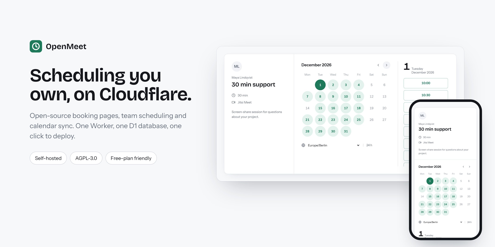
</p>

<p align="center">
  <a href="https://github.com/darkooom/OpenMeet/actions/workflows/ci.yml"></a>
  <a href="https://developers.cloudflare.com/workers/"></a>
  <a href="https://react.dev/"></a>
  <a href="https://www.typescriptlang.org/"></a>
  <a href="https://tailwindcss.com/"></a>
  <a href="./LICENSE"></a>
</p>

<p align="center">
  <a href="https://deploy.workers.cloudflare.com/?url=https://github.com/darkooom/OpenMeet"><b>Deploy to Cloudflare</b></a>
  &nbsp;·&nbsp;
  <a href="./DEPLOYMENT.md"><b>Deployment guide</b></a>
  &nbsp;·&nbsp;
  <a href="./docs/api.md"><b>API docs</b></a>
</p>

<br>

Booking a meeting should take one link and one click. Most scheduling tools
make that easy, but you rent them: your calendar, your customers' data and
your booking pages live on someone else's servers, priced per seat.

**OpenMeet is a scheduling platform you run yourself.** Booking pages, team
scheduling, calendar sync, reminders, workflows and an API, deployed to your own
Cloudflare account in one click. One Worker, one D1 database. No servers,
no containers, no Postgres, no Redis, and it fits Cloudflare's free plan for
small teams.

<p align="center">
  <a href="https://deploy.workers.cloudflare.com/?url=https://github.com/darkooom/OpenMeet"></a>
</p>

## Quick start

```bash
git clone https://github.com/darkooom/OpenMeet.git
cd OpenMeet
npm ci
cp .dev.vars.example .dev.vars   # put two long random values in it
npm run db:migrate:local
npm run build
npx wrangler dev
```

Open <http://localhost:8787>. A fresh instance starts the setup wizard: enter
the `SETUP_TOKEN` from `.dev.vars`, create your admin account, and your first
booking page is live a minute later.

## What's inside

<table>
  <tr>
    <td width="50%" valign="top">
      <b>Booking pages people enjoy</b><br>
      Calendar and time picker in the visitor's time zone, booking questions, multiple durations, confirmation with ICS file and Google Calendar link, reschedule and cancel links.
    </td>
    <td width="50%" valign="top">
      <b>Every kind of meeting</b><br>
      One-on-one, group sessions with seats, collective (all hosts) and round robin (next free host). Private and single-use links, manual confirmation.
    </td>
  </tr>
  <tr>
    <td valign="top">
      <b>No double bookings, ever</b><br>
      Reservations are written in one D1 transaction and checked by database triggers. 25 parallel requests for one slot produce exactly one booking, and the tests prove it.
    </td>
    <td valign="top">
      <b>Your calendars, connected</b><br>
      Google Calendar, Microsoft 365 / Outlook, CalDAV and ICS feeds for conflicts. Events are created in your calendar with Google Meet, Teams, Zoom or Jitsi links.
    </td>
  </tr>
  <tr>
    <td valign="top">
      <b>Automation built in</b><br>
      Reminders 24 h and 1 h before, workflows with e-mail, Slack, Teams, webhook and HTTP steps, signed webhooks with retries, and routing forms that send visitors to the right meeting.
    </td>
    <td valign="top">
      <b>Made for teams and agents</b><br>
      Organizations, teams, invitations and roles. A versioned REST API with scoped keys, OpenAPI and a TypeScript SDK, plus an agent API for AI assistants.
    </td>
  </tr>
</table>

## Product tour

### The booking page

The page your customers actually see. Free days are highlighted, times appear in the visitor's own time zone, and daylight-saving switches are handled for you.

<picture>
  <source media="(prefers-color-scheme: dark)" srcset="docs/readme/booking-dark.jpg">
  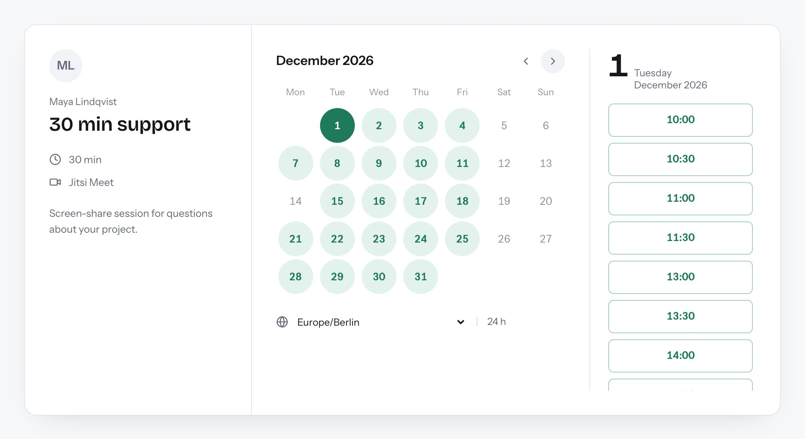
</picture>

### Dashboard

Today first, what's coming next, then what just happened. Warnings tell you when something needs attention, like a missing e-mail provider or a calendar that lost access.

<picture>
  <source media="(prefers-color-scheme: dark)" srcset="docs/readme/dashboard-dark.jpg">
  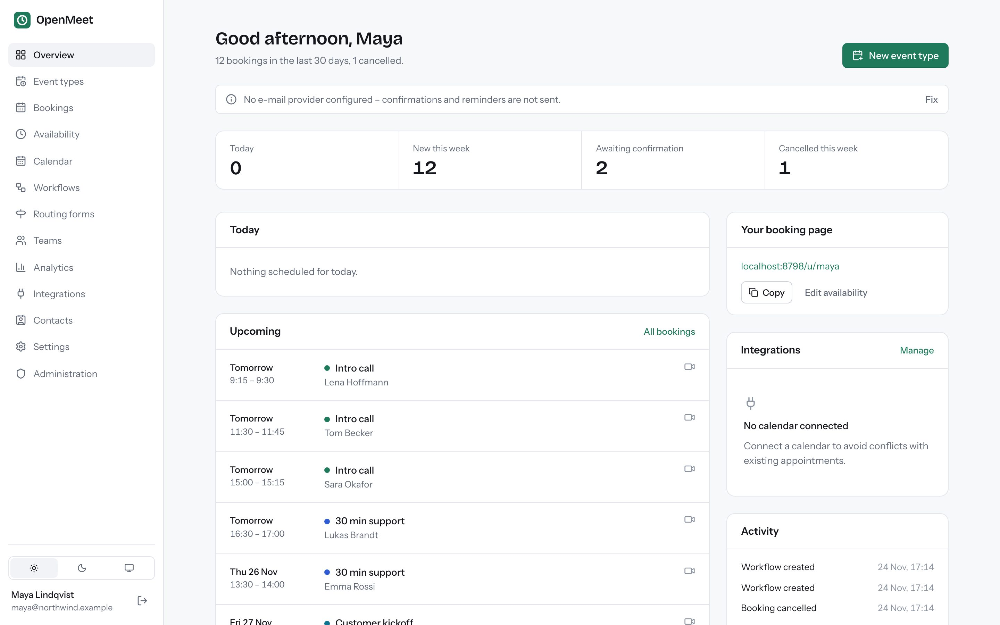
</picture>

<table>
  <tr>
    <td width="50%" valign="top">
      <picture>
        <source media="(prefers-color-scheme: dark)" srcset="docs/readme/event-types-dark.jpg">
        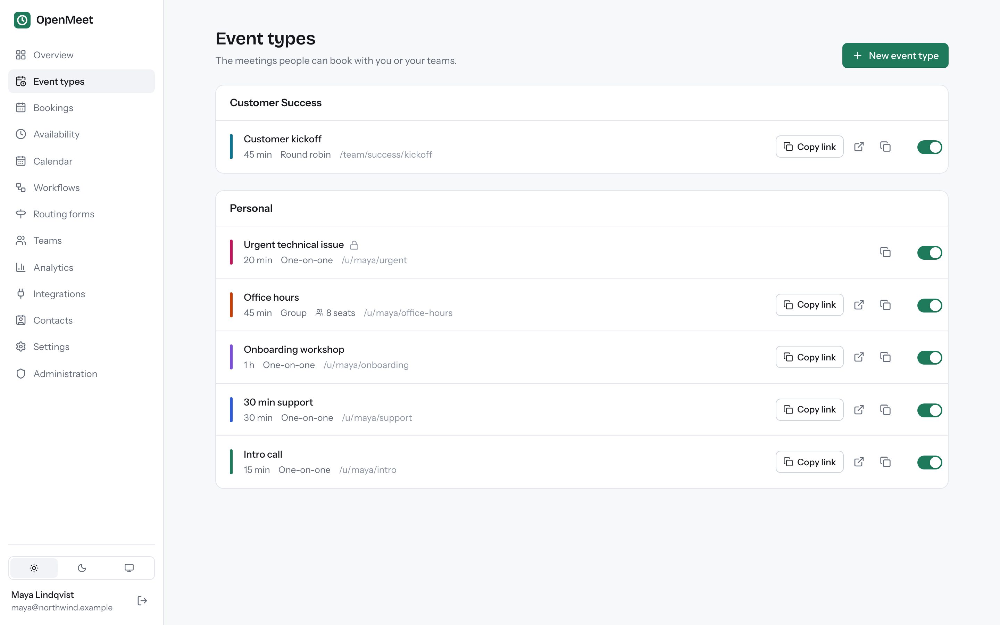
      </picture>
      <p align="center"><b>Event types</b><br><sub>Personal and team meetings, copy link, on/off switch</sub></p>
    </td>
    <td width="50%" valign="top">
      <picture>
        <source media="(prefers-color-scheme: dark)" srcset="docs/readme/bookings-dark.jpg">
        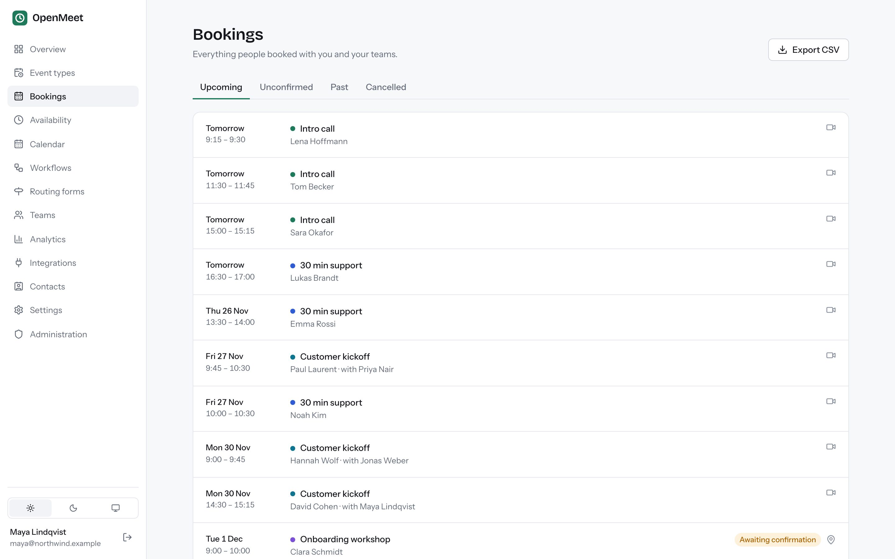
      </picture>
      <p align="center"><b>Bookings</b><br><sub>Upcoming, unconfirmed, past and cancelled, with CSV export</sub></p>
    </td>
  </tr>
  <tr>
    <td valign="top">
      <picture>
        <source media="(prefers-color-scheme: dark)" srcset="docs/readme/availability-dark.jpg">
        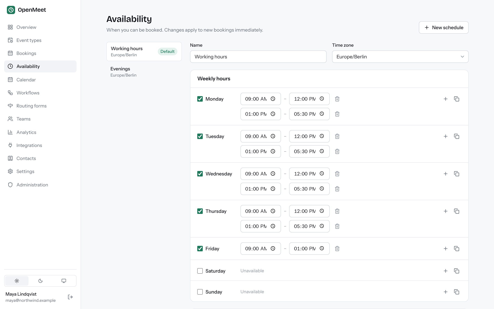
      </picture>
      <p align="center"><b>Availability</b><br><sub>Several schedules, lunch breaks, holidays and vacation</sub></p>
    </td>
    <td valign="top">
      <picture>
        <source media="(prefers-color-scheme: dark)" srcset="docs/readme/calendar-dark.jpg">
        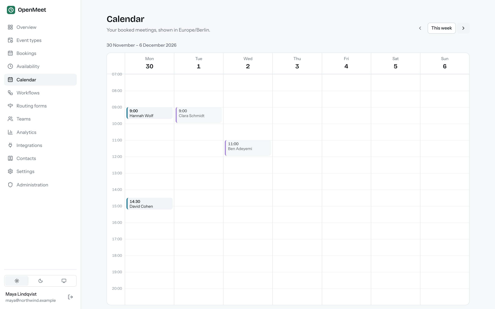
      </picture>
      <p align="center"><b>Calendar</b><br><sub>Your week at a glance, in your time zone</sub></p>
    </td>
  </tr>
  <tr>
    <td valign="top">
      <picture>
        <source media="(prefers-color-scheme: dark)" srcset="docs/readme/workflows-dark.jpg">
        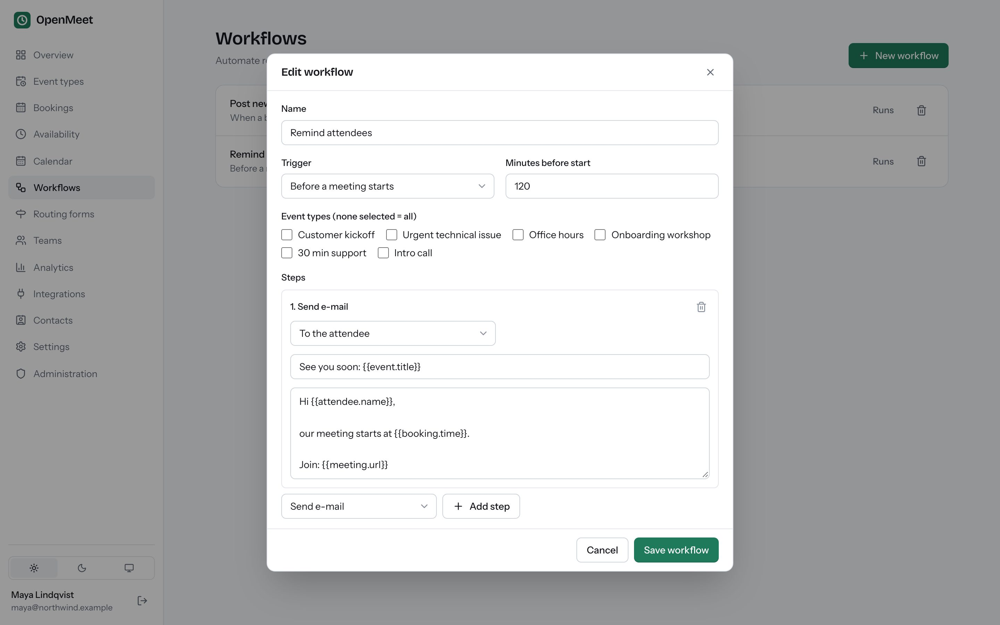
      </picture>
      <p align="center"><b>Workflows</b><br><sub>Triggers, delays, e-mail, Slack, Teams, webhooks, HTTP</sub></p>
    </td>
    <td valign="top">
      <picture>
        <source media="(prefers-color-scheme: dark)" srcset="docs/readme/teams-dark.jpg">
        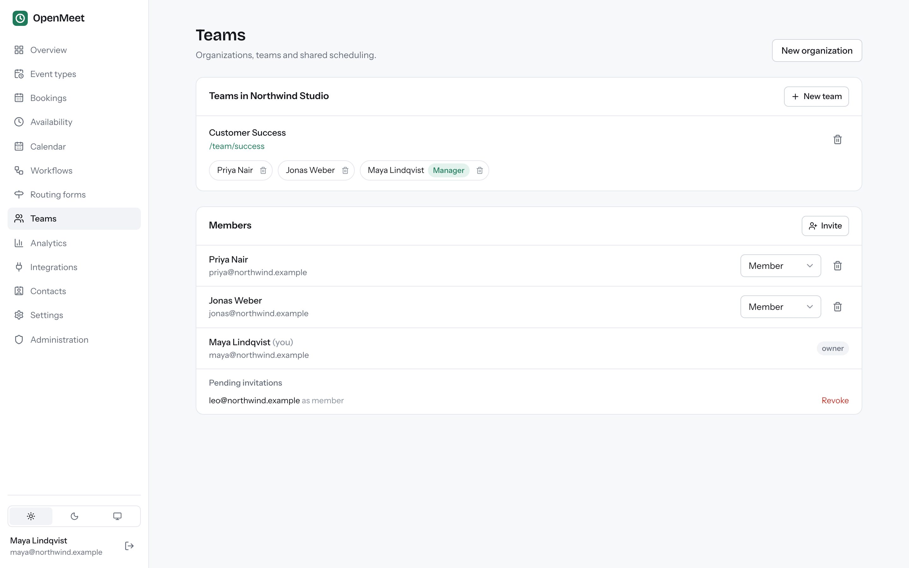
      </picture>
      <p align="center"><b>Teams</b><br><sub>Organizations, members, roles and invitations</sub></p>
    </td>
  </tr>
  <tr>
    <td valign="top">
      <picture>
        <source media="(prefers-color-scheme: dark)" srcset="docs/readme/analytics-dark.jpg">
        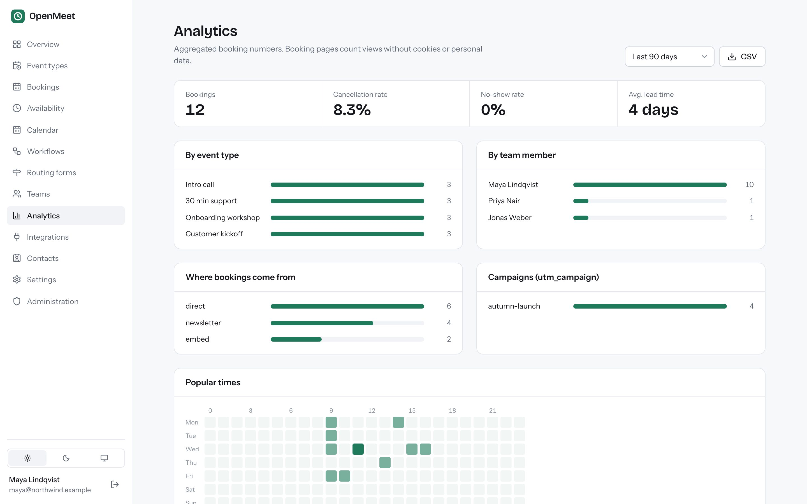
      </picture>
      <p align="center"><b>Analytics</b><br><sub>Cancellation and no-show rates, sources, UTM, popular times, without cookies</sub></p>
    </td>
    <td valign="top">
      <picture>
        <source media="(prefers-color-scheme: dark)" srcset="docs/readme/admin-dark.jpg">
        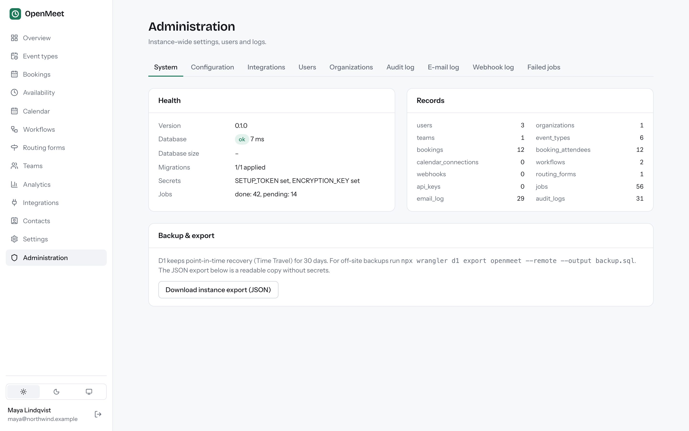
      </picture>
      <p align="center"><b>Administration</b><br><sub>Users, configuration, integrations, logs, failed jobs, export</sub></p>
    </td>
  </tr>
</table>

### Light and dark, both first-class

Both themes come from one set of tokens: cool paper and graphite, with a calm
fern green that is reserved for actions and confirmed states. The images in this
README follow your GitHub theme. Switch it to see the other one.

### Built for the phone

Most people book from their phone. The booking flow works one-handed on small screens.

<p align="center">
  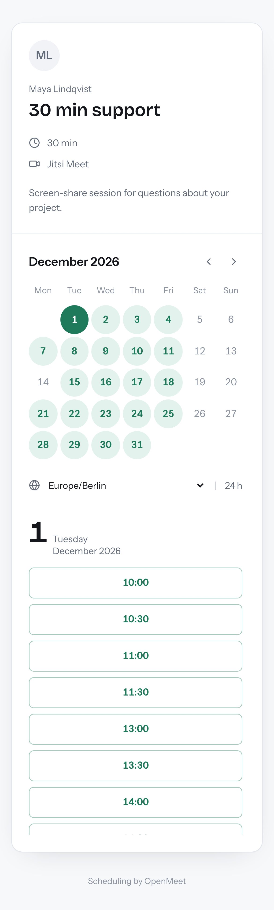
  &nbsp;
  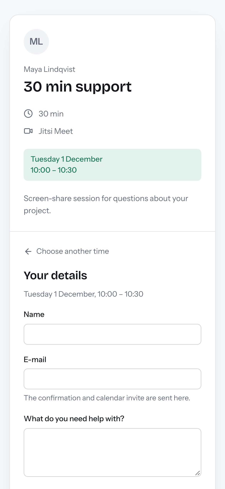
</p>

## One click, your account

| Step | What happens |
| --- | --- |
| Deploy | Cloudflare copies this repository to your GitHub or GitLab account and creates the Worker |
| Database | A D1 database is provisioned and bound automatically. No IDs live in this repository |
| Secrets | You set `SETUP_TOKEN` and `ENCRYPTION_KEY`, two random strings |
| Build | `npm run build`, then `npm run deploy` applies the database migrations and deploys |
| Setup | Open your `*.workers.dev` URL. The token-protected wizard creates the admin and locks itself |
| Updates | Every push to `main` redeploys through Workers Builds |

A custom domain such as `meet.example.com` is optional and takes two minutes; see [DEPLOYMENT.md](./DEPLOYMENT.md#custom-domain).

## Architecture

Everything runs in a single Worker. The API and the React app ship together,
the database is D1, and a cron trigger drains a persistent job queue for
e-mails, reminders, calendar sync, workflows and webhooks.

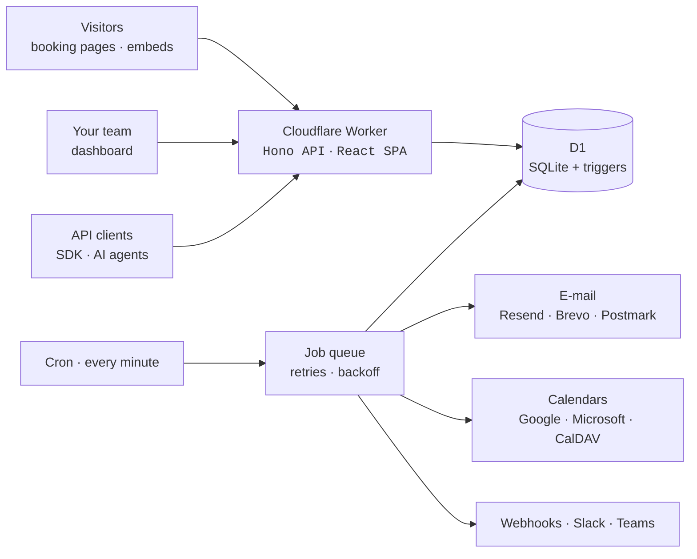

Integrations are adapters behind small interfaces in `src/server/integrations`.
Adding a calendar or e-mail provider means writing one adapter, not touching the
booking engine. Details and trade-offs: [ARCHITECTURE.md](./ARCHITECTURE.md).

## Integrations

Everything is optional. Without any provider OpenMeet still books meetings, generates Jitsi links and tells you clearly which features are off.

<details>
  <summary><b>E-mail</b> (Resend, Brevo, Postmark)</summary>

Administration → Integrations → E-mail provider. Add the API key and a verified
sender, then use **Send test e-mail**. Confirmations, reminders, cancellations and
reschedules are sent in English or German with ICS attachments.

</details>

<details>
  <summary><b>Google</b> (sign-in, Calendar, Meet)</summary>

Create an OAuth client in Google Cloud, enable the Calendar API and add
`https://<your-domain>/auth/oauth/google/callback` as redirect URI. Paste client ID
and secret in Administration → Integrations. Step by step: [docs/integrations.md](./docs/integrations.md#google).

</details>

<details>
  <summary><b>Microsoft</b> (sign-in, Outlook, Teams)</summary>

Register an app in Microsoft Entra with `Calendars.ReadWrite`, `User.Read` and
`offline_access`, redirect URI `https://<your-domain>/auth/oauth/microsoft/callback`.
Step by step: [docs/integrations.md](./docs/integrations.md#microsoft).

</details>

<details>
  <summary><b>Zoom, CalDAV, ICS feeds</b></summary>

See [docs/integrations.md](./docs/integrations.md). CalDAV works with iCloud,
Fastmail and Nextcloud using app passwords; any calendar's iCal address can be
added as a read-only conflict source.

</details>

<details>
  <summary><b>Embed on your website</b></summary>

```html
<button data-openmeet="maya/intro">Book a call</button>
<script src="https://meet.example.com/embed.js" async></script>
```

Inline widget, popup and floating button, with guides for React, Next.js,
WordPress and Webflow in [docs/embed.md](./docs/embed.md).

</details>

<details>
  <summary><b>API, SDK and AI agents</b></summary>

```ts
import { OpenMeet } from "@openmeet/sdk";

const om = new OpenMeet({ baseUrl: "https://meet.example.com", apiKey: process.env.OPENMEET_API_KEY! });
const { data } = await om.availability({ eventTypeId: "…" });
await om.createBooking({ eventTypeId: "…", start: data.slots[0].startMs, name: "Ada", email: "ada@example.com", timezone: "Europe/Berlin" });
```

Scoped API keys, cursor pagination, idempotency keys, signed webhooks and an
OpenAPI document at `/api/v1/openapi.json`. Service tokens with the `agent` scope
let assistants check availability, book, reschedule and cancel, with every call
in the audit log. See [docs/api.md](./docs/api.md).

</details>

## Going to production

- [ ] Deploy with the button and set `SETUP_TOKEN` and `ENCRYPTION_KEY`
- [ ] Finish the setup wizard (it locks itself afterwards)
- [ ] Configure an e-mail provider and send a test e-mail
- [ ] Add Google or Microsoft OAuth apps if your team should connect calendars
- [ ] Connect a custom domain and set the public URL
- [ ] Set up backups with D1 Time Travel or `wrangler d1 export` ([guide](./docs/backup-restore.md))
- [ ] Store `ENCRYPTION_KEY` in your password manager. Never rotate it without reconnecting integrations

## Project structure

```text
src/
├── server/              Cloudflare Worker (Hono)
│   ├── routes/          API: setup, auth, dashboard, public, admin, v1 + agent
│   ├── services/        Slot engine, booking engine, jobs, notifications, workflows
│   ├── integrations/    Calendar, e-mail, meeting and OAuth adapters
│   ├── security/        Crypto, SSRF guard, rate limits, redaction
│   └── middleware/      Context, sessions, API keys, CSRF
├── web/                 React app: dashboard, booking pages, setup wizard
├── components/ui/       shadcn-style UI primitives
├── shared/              Zod schemas and time-zone math used on both sides
└── database/            Drizzle schema and runtime migrator
migrations/              D1 SQL migrations (incl. booking triggers)
public/                  embed.js, security headers, icons
sdk/                     TypeScript SDK
tests/                   Unit, integration (workerd + D1) and Playwright E2E
```

| Command | What it does |
| --- | --- |
| `npm run dev` | Worker on :8787 and Vite with hot reload on :5173 |
| `npm run build` | Build the React app into `dist/client` |
| `npm run deploy` | Apply migrations and deploy to Cloudflare |
| `npm run typecheck` | Type-check Worker, web app and tooling |
| `npm run lint` | Run ESLint |
| `npm run test` | Unit and integration tests (real D1 in workerd) |
| `npm run test:e2e` | Fresh install to booking, reschedule and cancel in Playwright |
| `npm run check:deploy` | Build and `wrangler deploy --dry-run` |
| `npm run readme:screens` | Regenerate the screenshots in this README |

## Status

Version 0.1. The core (setup, booking engine, availability, teams, workflows,
API) is implemented and tested. Some provider integrations are implemented but
not yet verified against live accounts. [PROGRESS.md](./PROGRESS.md) lists the
exact status of every feature and the known gaps.

## Contributing and security

Issues and pull requests are welcome. Run `npm run lint`, `npm run typecheck` and
`npm run test` before opening a pull request. Please report vulnerabilities
privately through
[GitHub Private Vulnerability Reporting](https://github.com/darkooom/OpenMeet/security/advisories/new),
not in a public issue. The security model is described in [SECURITY.md](./SECURITY.md).

## License

[AGPL-3.0](./LICENSE). Free to use, modify and self-host. If you offer a modified
version as a network service, you must share its source code with its users.
Third-party licenses: [docs/third-party-licenses.md](./docs/third-party-licenses.md).
