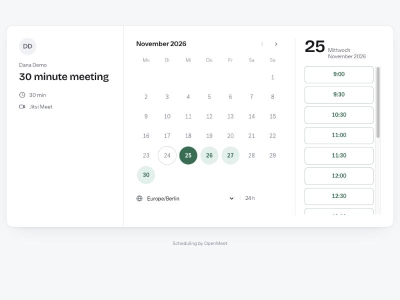
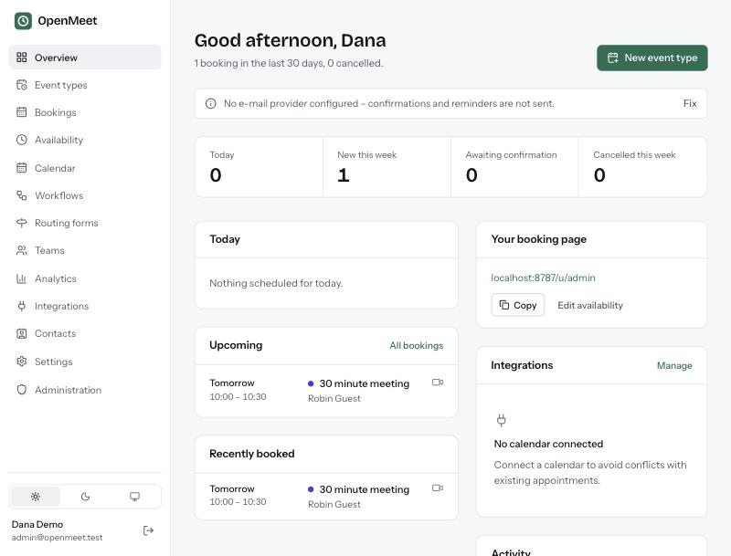
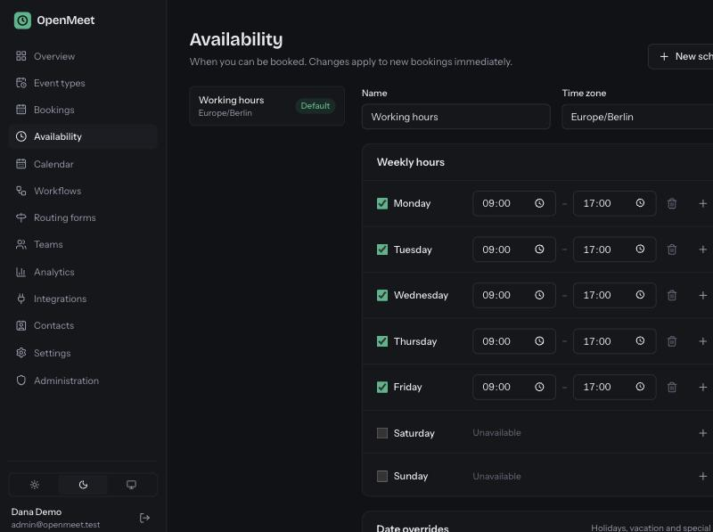
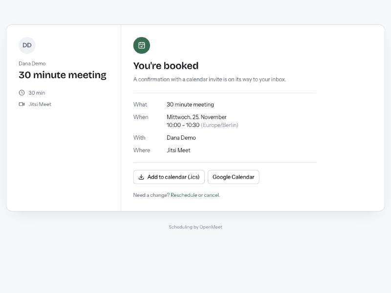
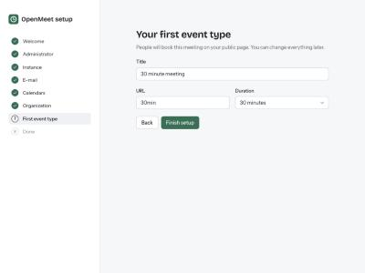

[](https://deploy.workers.cloudflare.com/?url=https://github.com/darkooom/OpenMeet)

# OpenMeet

**Open-source scheduling for people and teams – self-hosted on Cloudflare in one click.**

OpenMeet lets people book time with you without the back-and-forth: share a link, visitors pick a free slot, and the meeting lands in your calendar. It runs as a single Cloudflare Worker with a D1 database – no servers, containers, Postgres or Redis – and fits comfortably in Cloudflare's free plan for small teams.



| Dashboard | Availability (dark mode) |
| --- | --- |
|  |  |

| Booking confirmed | Setup wizard |
| --- | --- |
|  |  |

_Screenshots of the actual application running locally (`wrangler dev`)._

## Features

**Scheduling**
- Unlimited event types: one-on-one, group (seats), collective (all hosts) and round robin
- Multiple durations, buffers, minimum notice, booking window, daily/weekly limits, custom start intervals
- Custom booking questions, required fields, redirects, confirmation texts, brand colours
- Manual confirmation, private event types and single-use booking links
- Locations: Google Meet, Microsoft Teams, Zoom, Jitsi, custom video link, phone, in person
- Availability editor: multiple schedules, several ranges per day, date overrides for holidays, vacation and special hours
- IANA time zones with correct DST handling; times stored in UTC
- **Atomic double-booking protection** enforced by D1 triggers (proven by parallel-request tests)
- Reschedule & cancel links for attendees, ICS files, "add to Google Calendar"

**Integrations**
- Google Calendar & Microsoft 365/Outlook: OAuth (PKCE), free/busy conflict checks, event creation/update/deletion, token refresh
- CalDAV (iCloud, Fastmail, Nextcloud …) and read-only ICS feeds
- E-mail via Resend, Brevo or Postmark: confirmations, cancellations, reschedules, reminders (24 h / 1 h), organizer notifications, no-show follow-ups, ICS attachments, delivery log
- Workflows: triggers (created, confirmed, cancelled, rescheduled, before start, after end, no-show) with e-mail, delay, signed webhook, Slack, Microsoft Teams and HTTP steps – SSRF-protected
- Signed outgoing webhooks with retries and delivery log
- Routing forms that send visitors to the right event type
- Embed SDK: inline, popup and floating button
- REST API v1 with scoped API keys, OpenAPI spec and TypeScript SDK; agent service API for AI assistants

**Organisation & administration**
- Organizations, teams, invitations, roles (instance admin, owner, admin, team manager, member)
- Dashboard with today/upcoming bookings, stats, integration status and activity
- Privacy-friendly analytics (no cookies), CSV export
- Admin area: users, registration policy, configuration, integrations, audit/e-mail/webhook logs, failed jobs, health, JSON export
- Data export and account deletion for every user, configurable data retention

See [PROGRESS.md](PROGRESS.md) for the exact implementation and test status of every feature.

## Installation

### One click (recommended)

1. Click **Deploy to Cloudflare** above.
2. Cloudflare copies this repository to your GitHub/GitLab account, creates the Worker and the **D1 database** automatically.
3. You are asked for two secrets:
   - `SETUP_TOKEN` – any long random string (`openssl rand -hex 24`). You will type it into the setup wizard once.
   - `ENCRYPTION_KEY` – `openssl rand -hex 32`. Encrypts OAuth tokens and provider keys. **Never change it later.**
4. Cloudflare builds the app (`npm run build`), applies the database migrations and deploys (`npm run deploy`).
5. Open the `*.workers.dev` URL. The **setup wizard** asks for the setup token, creates your admin account, organization and first event type, and then locks itself permanently.

Details, the manual CLI route and Workers Builds (auto-deploy on push) are in [DEPLOYMENT.md](DEPLOYMENT.md).

### Manual (CLI)

```bash
git clone https://github.com/darkooom/OpenMeet && cd OpenMeet
npm ci
npx wrangler login
npx wrangler secret put SETUP_TOKEN
npx wrangler secret put ENCRYPTION_KEY
npm run build
npm run deploy
```

## Local development

```bash
npm ci
cp .dev.vars.example .dev.vars   # then put real random values in it
npm run db:migrate:local
npm run build                    # the Worker serves the built SPA from dist/client
npm run dev                      # wrangler dev on :8787 + Vite on :5173 (with API proxy)
```

Open http://localhost:5173 (hot reload) or http://localhost:8787 (production-like).

| Command | What it does |
| --- | --- |
| `npm run lint` | ESLint |
| `npm run typecheck` | TypeScript (Worker, web, tooling) |
| `npm run test:unit` | Slot engine, time zones/DST, crypto, SSRF, ICS, routing |
| `npm run test:integration` | API + D1 in workerd: auth, setup, tenancy, concurrency, integrations |
| `npm run test:e2e` | Playwright: fresh install → setup → booking → reschedule → cancel |
| `npm run check:deploy` | Build + `wrangler deploy --dry-run` |

## Custom domain

OpenMeet works on `workers.dev` out of the box. To use e.g. `meet.example.com`: add it under **Worker → Settings → Domains & Routes → Custom domain**, then set the **Public URL** in Administration → Configuration (and optionally the `ALLOWED_HOSTS` variable). Update OAuth redirect URIs afterwards. See [DEPLOYMENT.md](DEPLOYMENT.md#custom-domain).

## Integrations setup

- [Google OAuth / Calendar / Meet](docs/integrations.md#google)
- [Microsoft 365 / Outlook / Teams](docs/integrations.md#microsoft)
- [Zoom](docs/integrations.md#zoom)
- [E-mail providers (Resend, Brevo, Postmark)](docs/integrations.md#e-mail)
- [Embedding on your website (HTML, React, Next.js, WordPress, Webflow)](docs/embed.md)

## Architecture

One Worker, one database:

```
Browser ──► Cloudflare Worker (Hono)
             ├─ /api/*, /auth/*  → API, OAuth callbacks
             ├─ everything else  → static React SPA (Workers Static Assets)
             ├─ Cron (every min) → job queue: e-mails, reminders, workflows, webhooks, calendar sync
             └─ D1 (SQLite)      → all data; triggers enforce no double bookings
```

Read [ARCHITECTURE.md](ARCHITECTURE.md) for the data model, the booking-atomicity design, the job system and the trade-offs.

## API

- OpenAPI: `GET /api/v1/openapi.json` on your instance
- Guide: [docs/api.md](docs/api.md) – API keys, scopes, pagination, idempotency, webhooks, agent API
- TypeScript SDK: [sdk/](sdk/)

## Backup and restore

D1 Time Travel gives point-in-time recovery for 30 days; `wrangler d1 export` creates SQL dumps. See [docs/backup-restore.md](docs/backup-restore.md).

## Troubleshooting

| Problem | Fix |
| --- | --- |
| Setup wizard says the token is missing | Add `SETUP_TOKEN` and `ENCRYPTION_KEY` (≥ 32 chars) as Worker secrets and reload. |
| "Invalid setup token" | Compare with the secret you set; it is case-sensitive. After 10 attempts wait 15 minutes. |
| No e-mails arrive | Administration → Integrations → e-mail provider; check the E-mail log. Sender domain must be verified at the provider. |
| Booking page shows "does not exist" | The owner must confirm their e-mail (only when an e-mail provider is configured) and the event type must be active and not private. |
| OAuth "redirect_uri_mismatch" | The redirect URI shown in Administration must match exactly the one in the Google/Microsoft console. Set the Public URL first. |
| Calendar shows an error | Integrations → Sync. "revoked" means the user withdrew access – reconnect. |
| Reminders are late | Cron triggers run every minute; check Administration → Failed jobs. |

## Security

See [SECURITY.md](SECURITY.md) for the security model and how to report vulnerabilities.

## License

[AGPL-3.0-only](LICENSE). If you run a modified version as a network service, you must offer its source code to its users. Third-party licenses: [docs/third-party-licenses.md](docs/third-party-licenses.md).
